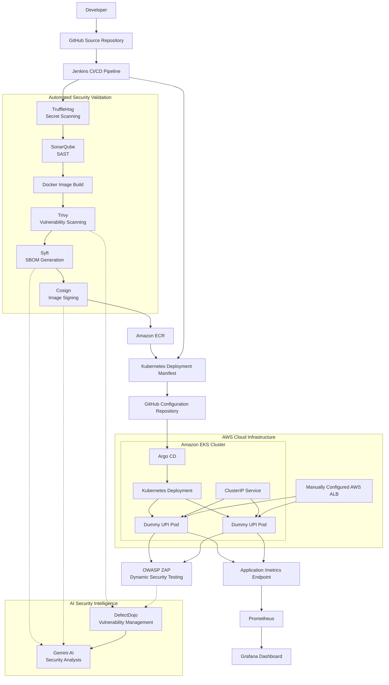
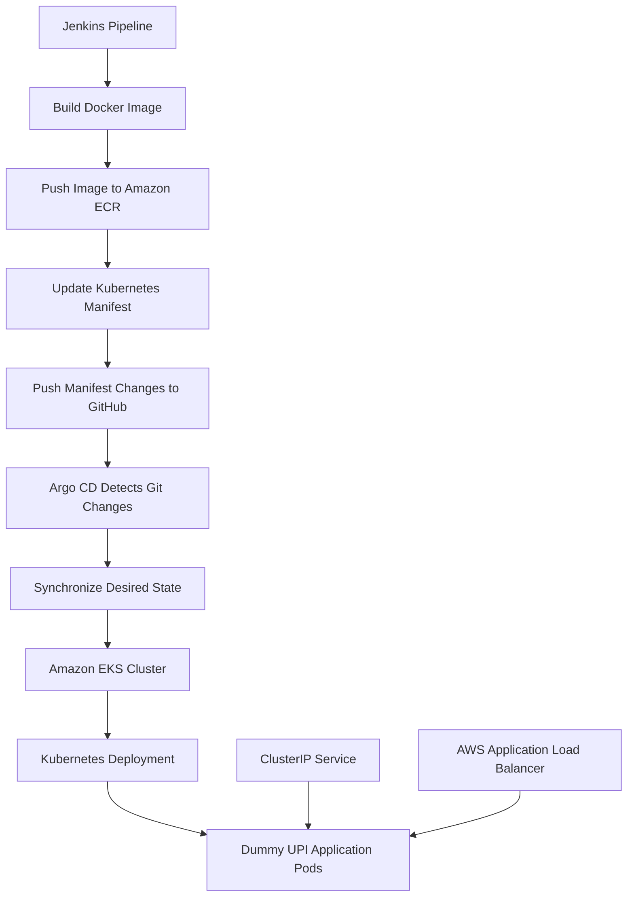
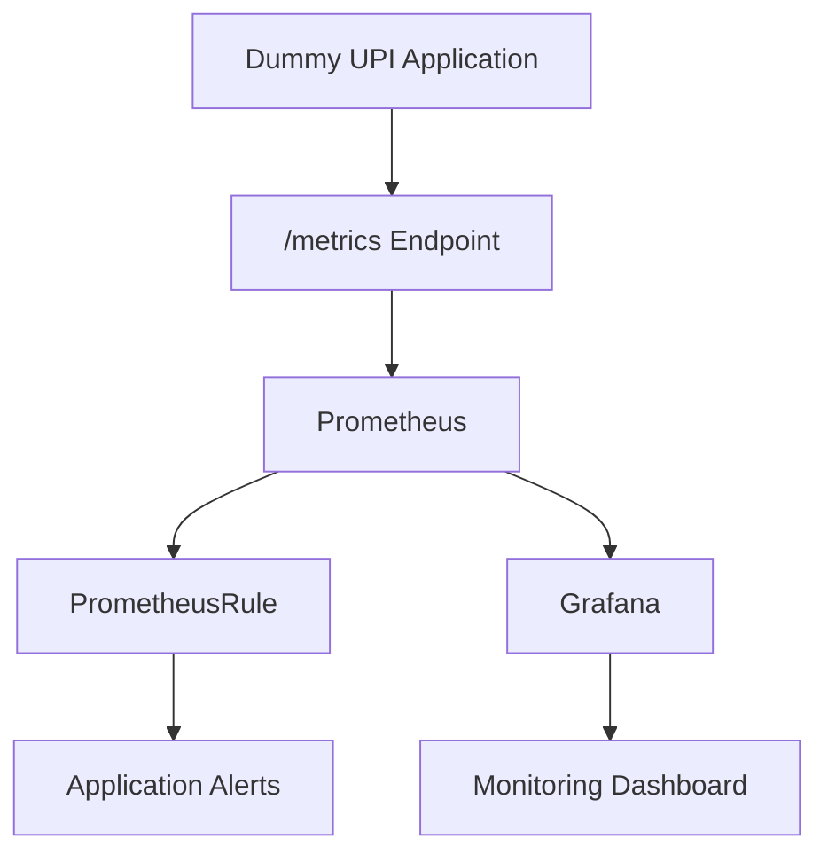

# Autonomous AI-Driven DevSecOps Engine

### An AI-Powered DevSecOps Platform for Automated Security Testing, Vulnerability Management, and Cloud-Native Deployment

---

## Overview

The **Autonomous AI-Driven DevSecOps Engine** is an end-to-end DevSecOps platform designed to integrate automated security testing, vulnerability management, software supply chain security, AI-assisted security analysis, and cloud-native application deployment into a unified CI/CD workflow.

The project demonstrates the implementation of security practices throughout the Software Development Lifecycle (SDLC), from source code analysis and container security testing to Kubernetes deployment and runtime monitoring.

A sample **Dummy UPI Application** is used as the target application to demonstrate the integration of security tools and automated deployment processes.

The platform uses Jenkins to orchestrate the CI/CD pipeline and integrates multiple security tools to identify potential security issues at different stages of application development.

An AI-powered security intelligence layer, integrated with Google Gemini, analyzes available security findings and generates remediation recommendations to assist in understanding and addressing vulnerabilities.

The application is containerized using Docker, with container images stored in Amazon Elastic Container Registry (ECR) and deployed on Amazon Elastic Kubernetes Service (EKS). Argo CD implements GitOps-based continuous delivery, while Prometheus and Grafana provide application monitoring and observability.

---

## Project Goals

The primary goals of this project are:

- Implement an automated DevSecOps CI/CD pipeline using Jenkins.
- Integrate security testing throughout the software development lifecycle.
- Detect exposed secrets and credentials in source code.
- Perform static and dynamic application security testing.
- Identify vulnerabilities in application dependencies and container images.
- Generate Software Bills of Materials (SBOMs).
- Implement container image signing and verification.
- Centralize security findings and vulnerability management.
- Integrate AI-assisted security analysis and remediation recommendations.
- Automate application containerization and image management.
- Deploy containerized applications to Amazon EKS.
- Implement GitOps-based continuous delivery using Argo CD.
- Configure application monitoring and observability using Prometheus and Grafana.

---

## Application Under Test

**Dummy UPI Application**

The project uses a sample UPI application as the application under test (AUT).

It provides a practical application environment for demonstrating:

- Source code security analysis.
- Dependency and container vulnerability scanning.
- Dynamic application security testing.
- Security findings management.
- Container image creation and deployment.
- Kubernetes-based application hosting.
- Application metrics collection and monitoring.

---

## Technology Stack

| Category | Technologies |
|---|---|
| Operating System | Windows, WSL2, Ubuntu |
| Source Code Management | Git, GitHub |
| CI/CD | Jenkins |
| Programming / AI Integration | Python, Google Gemini |
| Secret Scanning | TruffleHog |
| SAST | SonarQube |
| Containerization | Docker |
| Vulnerability Scanning | Trivy |
| DAST | OWASP ZAP |
| Vulnerability Management | DefectDojo |
| SBOM Generation | Syft |
| Image Signing | Cosign |
| Container Registry | Amazon ECR |
| Container Orchestration | Kubernetes, Amazon EKS |
| GitOps | Argo CD |
| Cloud Infrastructure | AWS |
| Load Balancing | AWS Application Load Balancer |
| Monitoring | Prometheus |
| Visualization | Grafana |

---

---

# Project Flow and System Architecture

## 1. Project Workflow

The Autonomous AI-Driven DevSecOps Engine follows an integrated workflow that connects source code management, automated security testing, AI-assisted security analysis, container image management, Kubernetes deployment, and application monitoring.

The overall workflow is divided into the following stages:

### Stage 1: Source Code Management

- Application source code is maintained in GitHub.
- Code changes trigger the Jenkins CI/CD workflow.
- Jenkins retrieves the latest source code from the repository.

### Stage 2: Automated Security Pipeline

Jenkins orchestrates the security validation process using integrated security tools.

- **TruffleHog:** Scans source code for exposed secrets and credentials.
- **SonarQube:** Performs Static Application Security Testing (SAST).
- **Docker:** Builds the application container image.
- **Trivy:** Scans the container image for known vulnerabilities.
- **Syft:** Generates the Software Bill of Materials (SBOM).
- **Cosign:** Signs and verifies container images.
- **OWASP ZAP:** Performs Dynamic Application Security Testing (DAST) against the running application.
- **DefectDojo:** Centralizes and manages vulnerability findings.

### Stage 3: AI Security Intelligence

The AI security intelligence layer integrates Google Gemini to analyze available security evidence.

- Processes security findings and scan information.
- Analyzes vulnerability details and security risks.
- Uses available SBOM and container security evidence.
- Generates AI-assisted remediation recommendations.

### Stage 4: Container Image Management

- Docker packages the application into a container image.
- Security validation is performed on the image.
- The application image is stored in Amazon Elastic Container Registry (ECR).

### Stage 5: GitOps-Based Deployment

- Jenkins updates the Kubernetes deployment manifest with the new image tag.
- Updated Kubernetes manifests are pushed to GitHub.
- Argo CD monitors the configured Git repository.
- Argo CD synchronizes the desired application state with Amazon EKS.

### Stage 6: Application Hosting and Load Balancing

- Amazon EKS hosts the containerized Dummy UPI application.
- Kubernetes Deployment manages application replicas.
- A ClusterIP Service provides internal application communication.
- An AWS Application Load Balancer is configured separately for external traffic routing.

### Stage 7: Monitoring and Observability

- The application exposes metrics through the `/metrics` endpoint.
- Prometheus collects application metrics.
- Grafana visualizes application performance and availability.
- Prometheus alerting rules identify application availability issues and HTTP 5xx errors.

---

## 2. High-Level System Architecture

The following diagram illustrates the logical architecture and integration of the project's major components.

*Note: This is a logical integration diagram, not a literal Jenkins execution graph. The arrows represent component relationships and data flow. The manually configured ALB is shown separately from Kubernetes Ingress. Exact target registration and security-tool execution order should be documented from the implementation configuration.*

---

## 3. Application Deployment Architecture

The application is deployed on Amazon Elastic Kubernetes Service (EKS).

The deployment architecture includes:

| Component | Description |
|---|---|
| Amazon VPC | Provides the networking environment for the EKS infrastructure |
| Amazon EKS | Managed Kubernetes control plane |
| Worker Nodes | Run the Kubernetes application workloads |
| Kubernetes Deployment | Manages the Dummy UPI application replicas |
| Application Pods | Run the containerized application |
| ClusterIP Service | Provides internal access to application pods |
| Amazon ECR | Stores application container images |
| AWS Application Load Balancer | Provides external application traffic routing |
| Argo CD | Synchronizes Kubernetes manifests from GitHub |

### Application Deployment Flow

### Deployment Configuration

The implemented application deployment included:

- Amazon EKS cluster: `autonomous-devsecops`
- AWS Region: `us-east-1`
- Kubernetes namespace: `devsecops`
- Application Deployment: `dummy-upi-app`
- Application Service: `dummy-upi-service`
- Container registry: Amazon ECR
- Configured application replicas: 2

During the recorded deployment, both application replicas were ready and available.

---

## 4. Monitoring Architecture

Prometheus and Grafana provide application monitoring and observability.

The application exposes Prometheus-compatible metrics through its `/metrics` endpoint.

The monitoring implementation includes:

- HTTP request metrics.
- HTTP 5xx error monitoring.
- Application availability monitoring.
- Container CPU usage monitoring.
- Prometheus alerting rules for application availability and HTTP 5xx errors.

---

## 5. Architecture Summary

The project brings together multiple DevSecOps practices into one integrated platform:

1. **Shift-Left Security:** Security testing is integrated into the CI/CD workflow.
2. **Automated Security Validation:** Multiple tools identify security weaknesses throughout development and deployment.
3. **AI-Assisted Security:** Gemini analyzes available security evidence and generates remediation recommendations.
4. **Software Supply Chain Security:** SBOM generation and container image signing improve software transparency and integrity.
5. **Cloud-Native Deployment:** Amazon EKS manages the containerized application.
6. **GitOps:** Argo CD synchronizes application deployment configurations from GitHub.
7. **Observability:** Prometheus and Grafana provide application monitoring and visualization.

---
