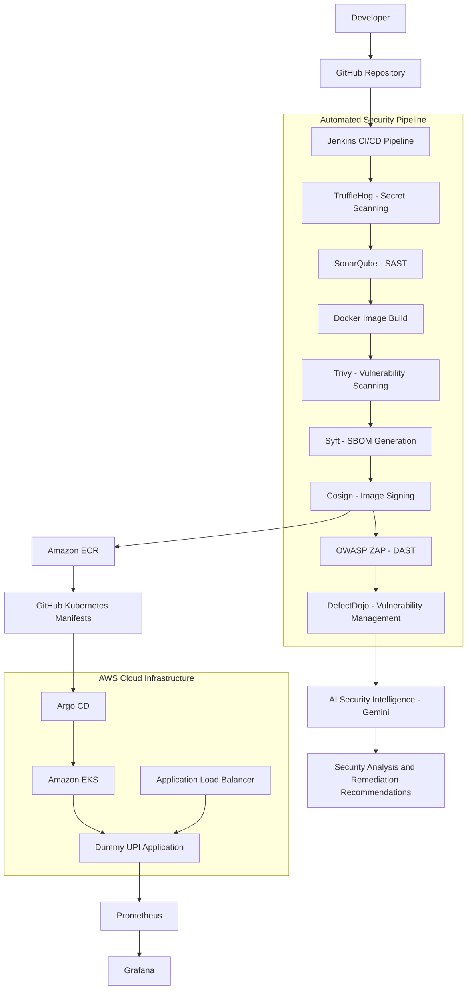

# Autonomous AI-Driven DevSecOps Engine

## AI-Powered Secure Software Development Lifecycle and Cloud-Native Deployment Platform

---

## Project Overview

The **Autonomous AI-Driven DevSecOps Engine** is an end-to-end DevSecOps platform designed to integrate security automation, vulnerability management, software supply chain security, AI-assisted security analysis, and cloud-native application deployment into a unified CI/CD workflow.

The platform demonstrates how security can be integrated throughout the Software Development Lifecycle (SDLC), from source-code development and automated security testing to containerization, deployment, and runtime monitoring.

A sample Dummy UPI application is used to demonstrate the implementation of automated security checks and deployment workflows.

The project integrates Jenkins-based CI/CD automation with multiple security tools, including TruffleHog, SonarQube, Trivy, OWASP ZAP, DefectDojo, Syft, and Cosign.

An AI-powered security intelligence layer analyzes security scan results and generates security insights and remediation recommendations.

The application is containerized using Docker, stored in Amazon Elastic Container Registry (ECR), and deployed to Amazon Elastic Kubernetes Service (EKS). Argo CD manages Kubernetes deployments through GitOps, while Prometheus and Grafana provide monitoring and observability.

---

## Project Objectives

The primary objective is to develop an automated DevSecOps platform capable of:

- Automating application build and deployment workflows using Jenkins.
- Detecting exposed secrets through TruffleHog.
- Performing Static Application Security Testing (SAST) using SonarQube.
- Scanning application dependencies and container images using Trivy.
- Performing Dynamic Application Security Testing (DAST) using OWASP ZAP.
- Centralizing vulnerability findings using DefectDojo.
- Generating Software Bills of Materials (SBOMs) using Syft.
- Signing and verifying container images using Cosign.
- Integrating AI-assisted security analysis and remediation recommendations.
- Containerizing applications using Docker.
- Managing container images using Amazon ECR.
- Deploying applications to Amazon EKS.
- Automating Kubernetes deployments through Argo CD GitOps.
- Monitoring application metrics using Prometheus and Grafana.
- Defining application availability and HTTP error alerting rules.

---

## Project Status

**Project implementation:** Completed

The project covers automated security testing, vulnerability management, software supply chain security, AI-assisted security analysis, container image management, Kubernetes deployment, GitOps synchronization, and application monitoring.

The AWS infrastructure was used during implementation and was subsequently shut down to avoid ongoing cloud costs. Therefore, the deployment described here represents the completed implementation rather than a currently running public service.

---

## System Architecture

The platform follows an integrated DevSecOps architecture that combines CI/CD automation, security testing, AI-assisted security analysis, container image management, GitOps-based deployment, and application monitoring.

### High-Level Architecture

*Note: The diagram represents the logical project workflow. The ALB was configured manually, separately from Kubernetes. Its exact target registration mechanism is not yet verified.*

---

## End-to-End DevSecOps Workflow

The project implements the following workflow:

### 1. Source Code Management

- Application source code is maintained in GitHub.
- Developers push code changes to the repository.
- Jenkins uses the repository as the source for pipeline execution.

### 2. CI/CD Pipeline Execution

Jenkins orchestrates the automated build and security validation process.

The pipeline integrates multiple security tools to identify vulnerabilities and security weaknesses at different stages of the development lifecycle.

### 3. Automated Security Testing

The application undergoes multiple security checks:

- **TruffleHog:** Detects exposed credentials, API keys, and secrets.
- **SonarQube:** Performs static code analysis and identifies code-quality and security issues.
- **Trivy:** Scans container images for known vulnerabilities.
- **Syft:** Generates a Software Bill of Materials (SBOM).
- **Cosign:** Supports container image signing and verification.
- **OWASP ZAP:** Performs dynamic security testing against the running application.
- **DefectDojo:** Provides centralized vulnerability management.

### 4. AI-Assisted Security Analysis

Security findings and generated artifacts are used by the AI security intelligence layer.

The integration with Gemini supports security analysis and generates remediation recommendations based on available scan evidence.

### 5. Containerization and Image Management

- Docker is used to package the application into a container image.
- Trivy scans the image for vulnerabilities.
- Syft generates the SBOM.
- Cosign provides image signing and verification.
- Validated application images are stored in Amazon Elastic Container Registry (ECR).

### 6. GitOps-Based Deployment

- Jenkins updates the Kubernetes deployment manifest with the new container image tag.
- The updated manifest is pushed to GitHub.
- Argo CD monitors the configured Git repository.
- Argo CD synchronizes the desired Kubernetes configuration with the Amazon EKS cluster.

### 7. Application Deployment

- Amazon EKS hosts the Kubernetes application.
- The Dummy UPI application runs as a Kubernetes Deployment.
- Two application replicas provide multiple running instances.
- A ClusterIP Service provides internal application networking.
- An AWS Application Load Balancer was configured separately for external application access.

### 8. Monitoring and Observability

- The application exposes Prometheus-compatible metrics through the `/metrics` endpoint.
- Prometheus collects application and infrastructure-related metrics.
- Grafana visualizes application requests, HTTP errors, application availability, and CPU usage.
- PrometheusRule resources define application availability and HTTP 5xx alert conditions.

---

## Core Architecture Components

| Component | Responsibility |
|---|---|
| GitHub | Source code and Kubernetes manifest management |
| Jenkins | CI/CD pipeline orchestration |
| TruffleHog | Secret detection |
| SonarQube | Static application security testing |
| Docker | Application containerization |
| Trivy | Vulnerability scanning |
| Syft | SBOM generation |
| Cosign | Container image signing and verification |
| OWASP ZAP | Dynamic application security testing |
| DefectDojo | Vulnerability management |
| Gemini | AI-assisted security analysis |
| Amazon ECR | Container image registry |
| Amazon EKS | Managed Kubernetes platform |
| Argo CD | GitOps continuous delivery |
| AWS ALB | External application traffic routing |
| Prometheus | Metrics collection and alert evaluation |
| Grafana | Monitoring dashboards and visualization |

---
