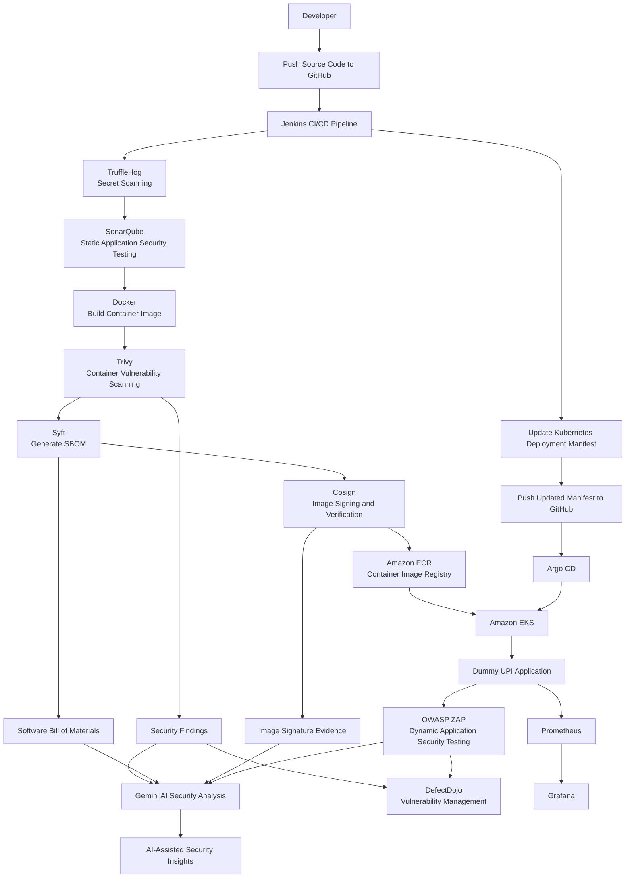
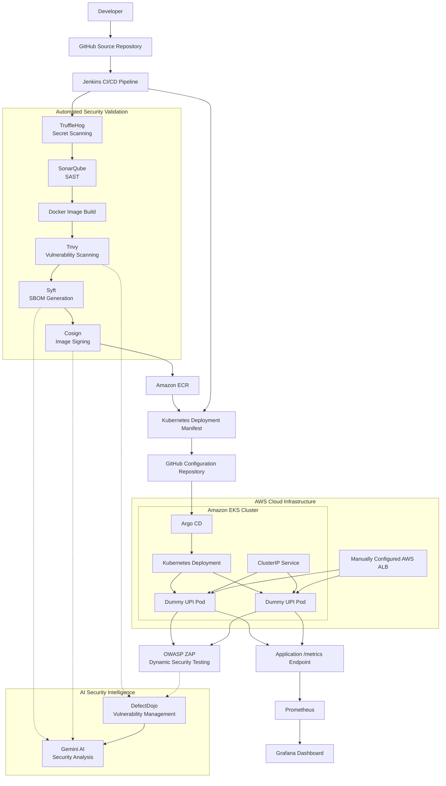
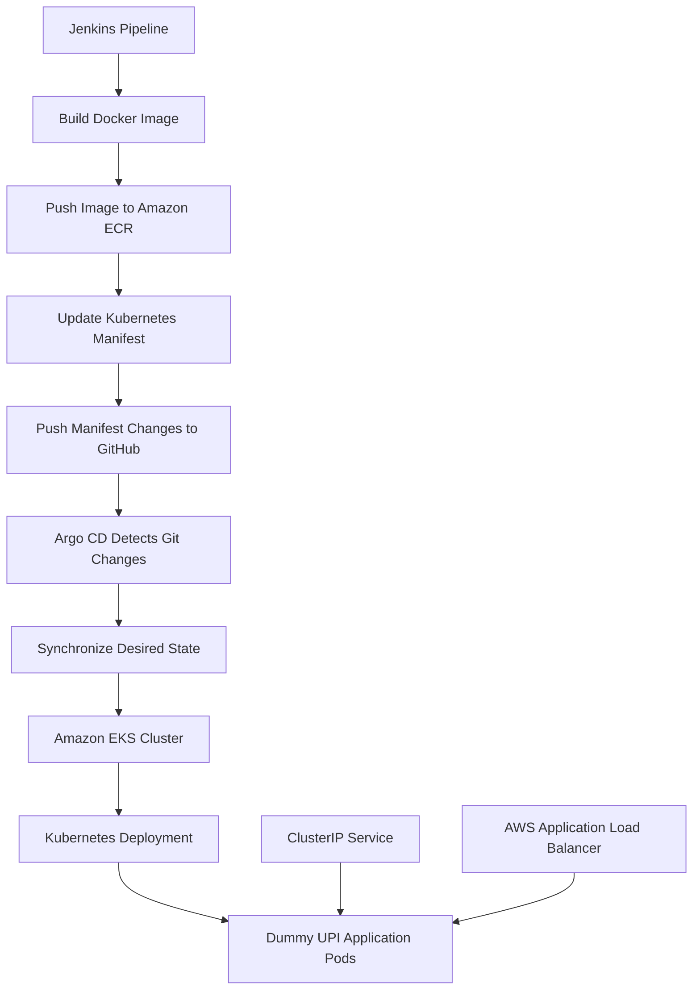
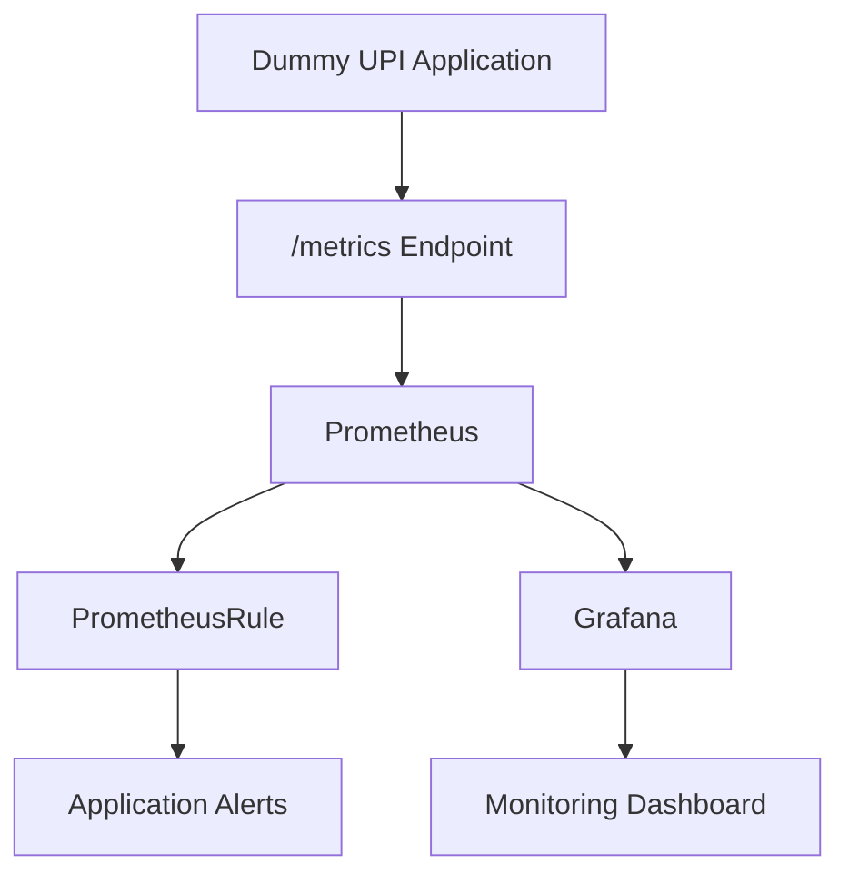

# Autonomous AI-Driven DevSecOps Engine

### An AI-Powered DevSecOps Platform for Automated Security Testing, Vulnerability Management, and Cloud-Native Deployment

---

## Overview

The **Autonomous AI-Driven DevSecOps Engine** is an end-to-end DevSecOps platform designed to integrate automated security testing, vulnerability management, software supply chain security, AI-assisted security analysis, and cloud-native application deployment into a unified CI/CD workflow.

The project demonstrates the implementation of security practices throughout the Software Development Lifecycle (SDLC), from source code analysis and container security testing to Kubernetes deployment and runtime monitoring.

A sample **Dummy UPI Application** is used as the target application to demonstrate the integration of security tools and automated deployment processes.

The platform uses Jenkins to orchestrate the CI/CD pipeline and integrates multiple security tools to identify potential security issues at different stages of application development.

An AI-powered security intelligence layer, integrated with Google Gemini, analyzes available security findings and generates remediation recommendations to assist in understanding and addressing vulnerabilities.

The application is containerized using Docker, with container images stored in Amazon Elastic Container Registry (ECR) and deployed on Amazon Elastic Kubernetes Service (EKS). Argo CD implements GitOps-based continuous delivery, while Prometheus and Grafana provide application monitoring and observability.

---

## Project Goals

The primary goals of this project are:

- Implement an automated DevSecOps CI/CD pipeline using Jenkins.
- Integrate security testing throughout the software development lifecycle.
- Detect exposed secrets and credentials in source code.
- Perform static and dynamic application security testing.
- Identify vulnerabilities in application dependencies and container images.
- Generate Software Bills of Materials (SBOMs).
- Implement container image signing and verification.
- Centralize security findings and vulnerability management.
- Integrate AI-assisted security analysis and remediation recommendations.
- Automate application containerization and image management.
- Deploy containerized applications to Amazon EKS.
- Implement GitOps-based continuous delivery using Argo CD.
- Configure application monitoring and observability using Prometheus and Grafana.

---

## Application Under Test

**Dummy UPI Application**

The project uses a sample UPI application as the application under test (AUT).

It provides a practical application environment for demonstrating:

- Source code security analysis.
- Dependency and container vulnerability scanning.
- Dynamic application security testing.
- Security findings management.
- Container image creation and deployment.
- Kubernetes-based application hosting.
- Application metrics collection and monitoring.

---

## Technology Stack

| Category | Technologies |
|---|---|
| Operating System | Windows, WSL2, Ubuntu |
| Source Code Management | Git, GitHub |
| CI/CD | Jenkins |
| Programming / AI Integration | Python, Google Gemini |
| Secret Scanning | TruffleHog |
| SAST | SonarQube |
| Containerization | Docker |
| Vulnerability Scanning | Trivy |
| DAST | OWASP ZAP |
| Vulnerability Management | DefectDojo |
| SBOM Generation | Syft |
| Image Signing | Cosign |
| Container Registry | Amazon ECR |
| Container Orchestration | Kubernetes, Amazon EKS |
| GitOps | Argo CD |
| Cloud Infrastructure | AWS |
| Load Balancing | AWS Application Load Balancer |
| Monitoring | Prometheus |
| Visualization | Grafana |

---

---

# Project Flow and System Architecture

## CI/CD Pipeline Flow

The Autonomous AI-Driven DevSecOps Engine integrates security practices into the CI/CD lifecycle. Jenkins orchestrates the build and security workflow, while automated security tools analyze the application source code, container image, and deployed application. Security evidence is further processed through DefectDojo and the Gemini-powered AI analysis layer.

### Pipeline Workflow

### 1. Source Code Management

- Application source code is maintained in GitHub.
- Developers push code changes to the repository.
- Jenkins uses the repository as the source for the CI/CD workflow.

### 2. Automated Security Scanning

The pipeline integrates multiple security tools to identify vulnerabilities at different stages:

| Tool | Purpose |
|---|---|
| TruffleHog | Detects exposed secrets and credentials in source code |
| SonarQube | Performs static code analysis to identify code quality and security issues |
| Trivy | Scans container images for known vulnerabilities |
| Syft | Generates a Software Bill of Materials (SBOM) |
| Cosign | Supports container image signing and signature verification |
| OWASP ZAP | Performs dynamic application security testing against the running application |

### 3. AI-Based Security Intelligence

The project incorporates a Gemini-powered AI security intelligence layer.

- Processes security evidence from Trivy, OWASP ZAP, SBOM generation, and Cosign.
- Helps analyze security findings and identify relevant remediation recommendations.
- Provides AI-assisted security insights to support vulnerability remediation.

### 4. Vulnerability Management

DefectDojo is integrated for vulnerability management.

- Security findings are handled through a centralized vulnerability management platform.
- Findings can be reviewed and tracked for remediation.
- It helps organize security information from the integrated testing tools.

### 5. Container Image Management

- Docker packages the Dummy UPI application into a container image.
- Trivy scans the image for known vulnerabilities.
- Syft generates the SBOM.
- Cosign provides image signing and verification capabilities.
- The container image is stored in Amazon Elastic Container Registry (ECR).

### 6. GitOps-Based Deployment

The deployment workflow uses Jenkins, GitHub, Argo CD, and Amazon EKS.

1. Jenkins updates the Kubernetes deployment manifest with the required container image tag.
2. The updated manifest is pushed to GitHub.
3. Argo CD monitors the Git repository.
4. Argo CD detects the manifest change and synchronizes the desired configuration.
5. The application is deployed to the Amazon EKS cluster.

### 7. Dynamic Application Security Testing

OWASP ZAP performs Dynamic Application Security Testing (DAST) against the running Dummy UPI application.

This helps identify security issues that may only become visible when the application is running.

### 8. Monitoring and Observability

Prometheus and Grafana provide application monitoring and visualization.

- **Prometheus:** Collects application and infrastructure metrics.
- **Grafana:** Visualizes metrics through dashboards.
- **Application Metrics:** The application exposes a `/metrics` endpoint using `prom-client`.
- **Alerting:** PrometheusRule resources define conditions for application availability and HTTP 5xx errors.

### Pipeline Outcome

The integrated workflow combines source code security, container security, AI-assisted security analysis, vulnerability management, GitOps-based deployment, and continuous monitoring.

It demonstrates how security can be incorporated throughout the application delivery lifecycle rather than being treated as a separate final-stage activity.

## 2. High-Level System Architecture

The following diagram illustrates the logical architecture and integration of the project's major components.

*Note: This is a logical integration diagram, not a literal Jenkins execution graph. The arrows represent component relationships and data flow. The manually configured ALB is shown separately from Kubernetes Ingress. Exact target registration and security-tool execution order should be documented from the implementation configuration.*

---

## 3. Application Deployment Architecture

The application is deployed on Amazon Elastic Kubernetes Service (EKS).

The deployment architecture includes:

| Component | Description |
|---|---|
| Amazon VPC | Provides the networking environment for the EKS infrastructure |
| Amazon EKS | Managed Kubernetes control plane |
| Worker Nodes | Run the Kubernetes application workloads |
| Kubernetes Deployment | Manages the Dummy UPI application replicas |
| Application Pods | Run the containerized application |
| ClusterIP Service | Provides internal access to application pods |
| Amazon ECR | Stores application container images |
| AWS Application Load Balancer | Provides external application traffic routing |
| Argo CD | Synchronizes Kubernetes manifests from GitHub |

### Application Deployment Flow

### Deployment Configuration

The implemented application deployment included:

- Amazon EKS cluster: `autonomous-devsecops`
- AWS Region: `us-east-1`
- Kubernetes namespace: `devsecops`
- Application Deployment: `dummy-upi-app`
- Application Service: `dummy-upi-service`
- Container registry: Amazon ECR
- Configured application replicas: 2

During the recorded deployment, both application replicas were ready and available.

---

## 4. Monitoring Architecture

Prometheus and Grafana provide application monitoring and observability.

The application exposes Prometheus-compatible metrics through its `/metrics` endpoint.

The monitoring implementation includes:

- HTTP request metrics.
- HTTP 5xx error monitoring.
- Application availability monitoring.
- Container CPU usage monitoring.
- Prometheus alerting rules for application availability and HTTP 5xx errors.

---

## 5. Architecture Summary

The project brings together multiple DevSecOps practices into one integrated platform:

1. **Shift-Left Security:** Security testing is integrated into the CI/CD workflow.
2. **Automated Security Validation:** Multiple tools identify security weaknesses throughout development and deployment.
3. **AI-Assisted Security:** Gemini analyzes available security evidence and generates remediation recommendations.
4. **Software Supply Chain Security:** SBOM generation and container image signing improve software transparency and integrity.
5. **Cloud-Native Deployment:** Amazon EKS manages the containerized application.
6. **GitOps:** Argo CD synchronizes application deployment configurations from GitHub.
7. **Observability:** Prometheus and Grafana provide application monitoring and visualization.

---
## Phase-wise Implementation

# Phase 1: Development Environment Setup

### Objective

Set up a Linux-based development environment on Windows to support the development and integration of the Autonomous AI-Driven DevSecOps Engine.

The project uses Windows Subsystem for Linux (WSL2) with Ubuntu 24.04 LTS as the primary development environment. Docker Desktop provides containerization support, while Visual Studio Code with the Remote - WSL extension enables development directly inside the Linux environment.

### Tools and Technologies

| Component | Technology |
|---|---|
| Host Operating System | Windows |
| Linux Environment | WSL2 |
| Linux Distribution | Ubuntu 24.04 LTS |
| Code Editor | Visual Studio Code |
| Editor Integration | Remote - WSL Extension |
| Container Platform | Docker Desktop |
| Version Control | Git |

### Implementation Steps

**1. Enable Windows Subsystem for Linux (WSL2)**

WSL2 provides a Linux environment within Windows without requiring a separate virtual machine.

The WSL2 environment is used to run Linux-based development tools and manage the DevSecOps project.

**2. Install Ubuntu 24.04 LTS**

Ubuntu 24.04 LTS is configured as the Linux distribution within WSL2.

The Ubuntu environment provides the shell and package-management capabilities required for installing and managing the project's development tools.

**3. Configure Visual Studio Code with WSL**

Visual Studio Code is integrated with the Ubuntu environment using the Remote - WSL extension.

This allows project files and development commands to be accessed directly inside the Linux environment.

**4. Configure Docker Desktop**

Docker Desktop is configured to use the WSL2 backend and integrate with the Ubuntu distribution.

This provides the containerization environment required to build and run application containers and support later CI/CD integration.

**5. Prepare the Development Environment**

The Linux environment is prepared for subsequent project implementation, including source code management, Jenkins configuration, security tool integration, and container development.

### Expected Outcome

- WSL2 configured on Windows.
- Ubuntu 24.04 LTS available as the Linux development environment.
- Visual Studio Code integrated with WSL.
- Docker Desktop configured with WSL2 integration.
- Development environment prepared for the next implementation phase.

**Phase Status:** Completed
