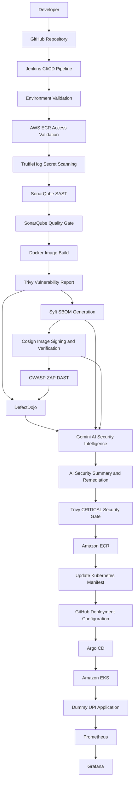
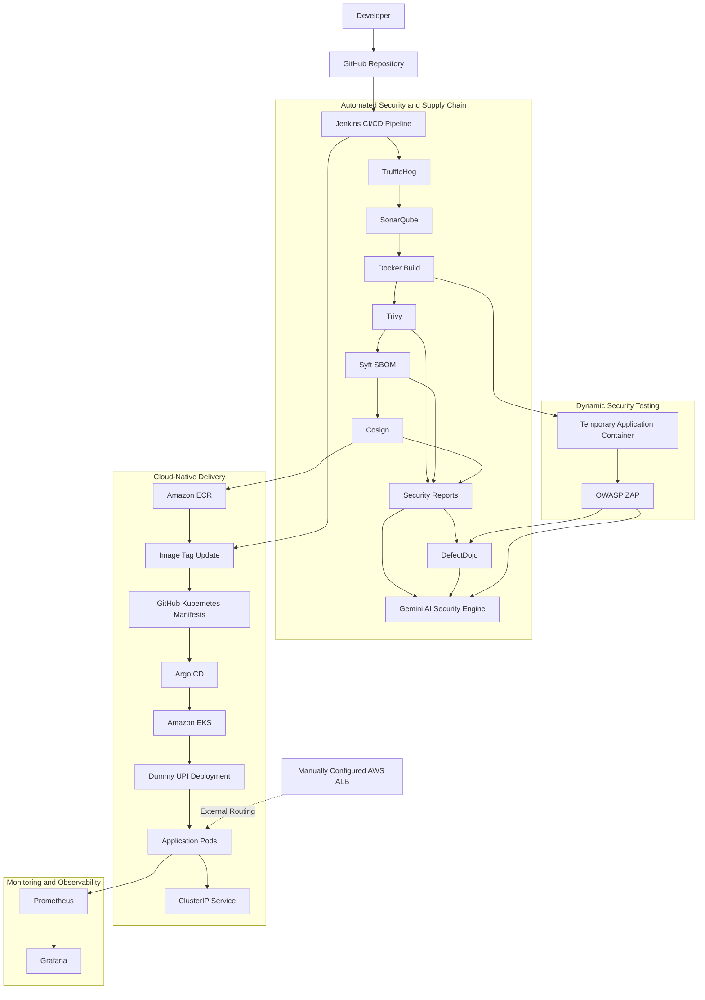
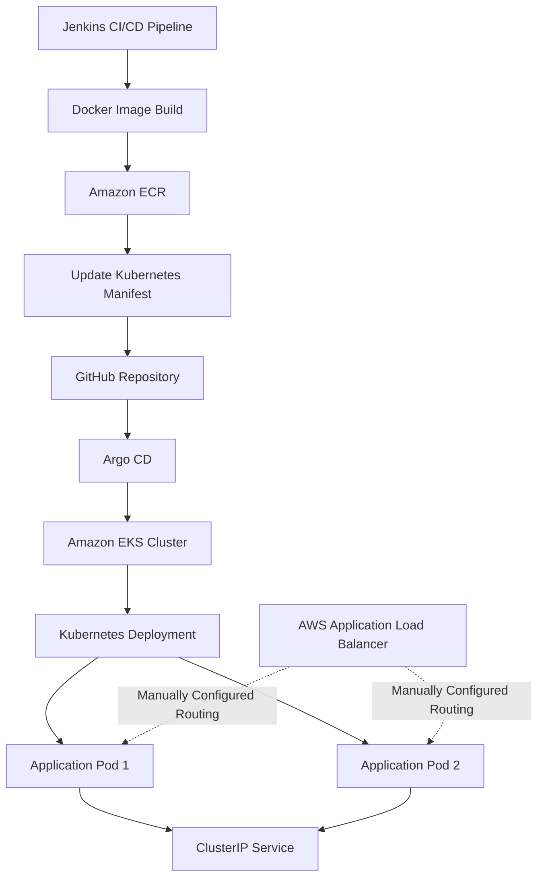
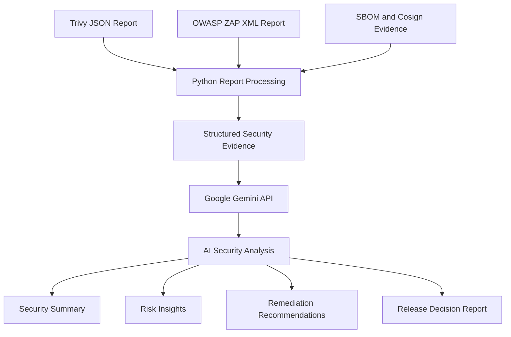
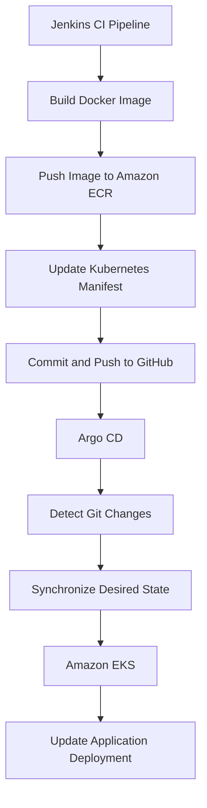

# Autonomous AI-Driven DevSecOps Engine

### An AI-Powered DevSecOps Platform for Automated Security Testing, Vulnerability Management, AI-Assisted Security Analysis, and Cloud-Native Deployment

---

# Table of Contents

1. [Project Overview](#1-project-overview)
2. [Project Objectives](#2-project-objectives)
3. [Application Under Test](#3-application-under-test)
4. [Technology Stack](#4-technology-stack)
5. [CI/CD Pipeline Flow](#5-cicd-pipeline-flow)
6. [High-Level System Architecture](#6-high-level-system-architecture)
7. [Application Deployment Architecture](#7-application-deployment-architecture)
8. [Monitoring and Observability Architecture](#8-monitoring-and-observability-architecture)
9. [Architecture Summary](#9-architecture-summary)
10. [Phase-wise Implementation](#10-phase-wise-implementation)
11. [Repository Structure](#11-repository-structure)
12. [Implementation Evidence and Reports](#12-implementation-evidence-and-reports)
13. [Project Outcomes](#13-project-outcomes)
14. [Future Enhancements](#14-future-enhancements)
15. [Conclusion](#15-conclusion)

---

# 1. Project Overview

The **Autonomous AI-Driven DevSecOps Engine** is an end-to-end DevSecOps platform designed to integrate automated security testing, vulnerability management, software supply chain security, AI-assisted security analysis, and cloud-native application deployment into a unified CI/CD workflow.

The project demonstrates the implementation of security practices throughout the Software Development Life Cycle (SDLC), covering source code analysis, secrets detection, vulnerability scanning, dynamic application security testing, container security, software supply chain security, and Kubernetes deployment.

A sample **Dummy UPI Application** is used as the Application Under Test (AUT) to demonstrate the integration of security tools and automated deployment processes.

Jenkins acts as the primary CI/CD automation server, coordinating the build and security workflow. Multiple security tools are integrated into the pipeline to identify potential security weaknesses at different stages of application development and delivery.

An AI-powered security intelligence layer, developed using Python and integrated with Google Gemini, analyzes available security findings and generates security summaries, risk insights, and remediation recommendations.

The application is containerized using Docker. Container images are stored in Amazon Elastic Container Registry (ECR) and deployed on Amazon Elastic Kubernetes Service (EKS).

Argo CD implements GitOps-based continuous delivery by synchronizing Kubernetes deployment configurations from GitHub. Prometheus and Grafana provide application monitoring, metrics collection, and observability.

The platform demonstrates how security automation, AI-assisted analysis, software supply chain security, cloud infrastructure, and GitOps can be integrated into a practical DevSecOps implementation.

## 1.1 Project Highlights

- Automated CI/CD pipeline using Jenkins.
- Secrets detection using TruffleHog.
- Static Application Security Testing using SonarQube.
- SonarQube Quality Gate integration.
- Container vulnerability scanning using Trivy.
- CRITICAL vulnerability security gate.
- Dynamic Application Security Testing using OWASP ZAP.
- Centralized vulnerability management using DefectDojo.
- Automated security report uploads to DefectDojo.
- SBOM generation using Syft.
- CycloneDX and SPDX SBOM formats.
- Container image artifact signing and verification using Cosign.
- AI-powered security intelligence using Python and Google Gemini.
- Docker-based application containerization.
- Amazon ECR image management.
- Amazon EKS application deployment.
- GitOps-based deployment using Argo CD.
- Manually configured AWS Application Load Balancer.
- Application monitoring using Prometheus and Grafana.

---

# 2. Project Objectives

The primary objective is to develop an integrated DevSecOps platform that incorporates automated security controls throughout the software delivery lifecycle.

The project focuses on the following objectives:

1. Implement an automated CI/CD pipeline using Jenkins and GitHub.
2. Integrate security testing throughout the SDLC.
3. Detect exposed secrets, credentials, and sensitive information in source code.
4. Perform Static Application Security Testing (SAST).
5. Implement SonarQube Quality Gate validation.
6. Identify vulnerabilities in application dependencies and container images.
7. Enforce security gates for critical vulnerabilities.
8. Perform Dynamic Application Security Testing (DAST).
9. Centralize security findings using DefectDojo.
10. Generate Software Bills of Materials (SBOMs).
11. Implement container image signing and verification.
12. Integrate AI-assisted security analysis using Google Gemini.
13. Generate security insights and remediation recommendations.
14. Automate application containerization using Docker.
15. Store application images in Amazon ECR.
16. Deploy containerized applications to Amazon EKS.
17. Implement GitOps-based continuous delivery using Argo CD.
18. Configure application monitoring and observability using Prometheus and Grafana.

---

# 3. Application Under Test

## Dummy UPI Application

The project uses a sample Dummy UPI application as the Application Under Test (AUT).

The application provides a practical environment for demonstrating the integration of security tools, automated CI/CD processes, and cloud-native deployment.

It acts as the target application for source code analysis, vulnerability scanning, dynamic security testing, containerization, and Kubernetes deployment.

### Application Security Testing

The application is used to demonstrate:

| Security Activity | Integrated Tool |
|---|---|
| Secret Detection | TruffleHog |
| Static Code Analysis | SonarQube |
| Dependency and Container Scanning | Trivy |
| Dynamic Application Security Testing | OWASP ZAP |
| Vulnerability Management | DefectDojo |
| SBOM Generation | Syft |
| Image Signing and Verification | Cosign |
| AI-Assisted Security Analysis | Google Gemini |

### Application Deployment

The Dummy UPI application is:

- Packaged into a Docker container image.
- Stored in Amazon ECR.
- Deployed to Amazon EKS.
- Managed through Kubernetes Deployment and Service resources.
- Exposed internally through a ClusterIP Service.
- Included in the application's monitoring workflow through Prometheus metrics.

---

# 4. Technology Stack

The following technologies and tools are used in the project.

| Category | Technologies |
|---|---|
| Host Operating System | Windows |
| Development Environment | WSL2, Ubuntu 24.04 LTS |
| Code Editor | Visual Studio Code |
| Version Control | Git, GitHub |
| CI/CD Automation | Jenkins |
| Programming and AI Integration | Python, Google Gemini |
| Secret Scanning | TruffleHog |
| Static Application Security Testing | SonarQube |
| Containerization | Docker |
| Vulnerability Scanning | Trivy |
| Dynamic Application Security Testing | OWASP ZAP |
| Vulnerability Management | DefectDojo |
| SBOM Generation | Syft |
| Container Image Signing | Cosign |
| Container Registry | Amazon ECR |
| Container Orchestration | Kubernetes, Amazon EKS |
| GitOps | Argo CD |
| Cloud Infrastructure | Amazon Web Services |
| Load Balancing | AWS Application Load Balancer |
| Metrics Collection | Prometheus |
| Monitoring and Visualization | Grafana |

---

# 5. CI/CD Pipeline Flow

The Autonomous AI-Driven DevSecOps Engine integrates security practices into the CI/CD lifecycle.

Jenkins orchestrates the automated security workflow, while individual tools perform source code analysis, vulnerability scanning, container security validation, dynamic testing, and software supply chain security operations.

The security reports generated during the pipeline are integrated with DefectDojo and the Gemini-powered AI security intelligence layer.

## 5.1 CI/CD Pipeline Workflow



*Note: The diagram represents the logical integration of the security and deployment components. The actual Jenkins stage sequence is documented below. The DAST scan runs against a temporary application container during the pipeline; the EKS deployment is a separate CD stage.*

## 5.2 Source Code Management

GitHub acts as the central source code management platform.

- Application source code is maintained in GitHub.
- Developers commit and push code changes to the repository.
- Jenkins retrieves the latest source code using SCM checkout.
- The repository contains the application, Jenkinsfile, Kubernetes manifests, AI security engine, reports, and supporting configuration files.

**Purpose:** Maintain a version-controlled source of truth for application development and CI/CD automation.

## 5.3 Jenkins CI/CD Orchestration

Jenkins is responsible for executing the automated CI/CD workflow.

The project uses a declarative `Jenkinsfile` to define pipeline stages.

The initial pipeline stages include:

1. Checkout Code.
2. DevSecOps Environment Check.
3. AWS ECR Credential and Access Check.

The environment validation stage checks the availability of required tools, including:

- Docker
- curl
- Node.js
- npm
- AWS CLI

The AWS access validation stage verifies the configured AWS identity and access to the `dummy-upi-app` ECR repository.

## 5.4 Secrets Detection – TruffleHog

TruffleHog is integrated to detect exposed secrets and credentials in the project workspace.

The Jenkins pipeline runs TruffleHog using Docker and scans the checked-out project files.

The scan focuses on identifying potentially exposed information such as:

- API keys.
- Passwords.
- AWS credentials.
- Access tokens.
- Other sensitive information.

**Purpose:** Detect accidentally committed credentials before application delivery.

## 5.5 Static Application Security Testing – SonarQube

SonarQube performs Static Application Security Testing (SAST) against the application source code.

Jenkins integrates with SonarQube using the configured SonarQube server and SonarScanner.

The pipeline performs:

1. Source code analysis.
2. Security and code-quality analysis.
3. Submission of analysis results to SonarQube.
4. Quality Gate evaluation.

The SonarQube Quality Gate integration provides a mechanism to evaluate the analysis result before proceeding with subsequent pipeline activities.

## 5.6 Containerization – Docker

After the initial source code security checks, Docker is used to package the Dummy UPI application.

The Jenkins pipeline builds the application image using the application's Dockerfile.

The generated local image is:

`dummy-upi-app:latest`

Docker provides a consistent containerized environment for application testing, vulnerability scanning, and deployment.

## 5.7 Container Vulnerability Scanning – Trivy

Trivy is integrated to scan the generated Docker image for known vulnerabilities.

The pipeline generates a JSON vulnerability report.

The report contains information about detected vulnerabilities and their associated severity levels.

The generated report is stored under:

`reports/trivy/trivy-image-report.json`

The pipeline also includes a CRITICAL vulnerability gate.

The enforcement configuration uses:

`--exit-code 1 --severity CRITICAL`

This allows the pipeline to return a failure status when CRITICAL vulnerabilities are detected by the configured security gate.

## 5.8 SBOM Generation – Syft

Syft is integrated to generate Software Bills of Materials for the Docker image.

The pipeline generates two SBOM formats:

| Format | Generated File |
|---|---|
| CycloneDX JSON | `reports/sbom/dummy-upi-app-cyclonedx.json` |
| SPDX JSON | `reports/sbom/dummy-upi-app-spdx.json` |

The SBOM provides an inventory of software components and packages included in the application image.

**Purpose:** Improve software component visibility and support software supply chain security.

## 5.9 Container Image Signing and Verification – Cosign

Cosign is integrated to implement container image artifact signing and verification.

The pipeline uses configured signing credentials to:

1. Prepare the Docker image artifact.
2. Generate a SHA-256 checksum.
3. Sign the image archive.
4. Generate a Sigstore bundle.
5. Verify the signature using the configured public key.
6. Store verification evidence.

Generated evidence includes:

- `reports/cosign/dummy-upi-app-image.sha256`
- `reports/cosign/dummy-upi-app-image.sigstore.json`
- `reports/cosign/cosign-verify-raw-output.txt`
- `reports/cosign/dummy-upi-app-signature-verification.txt`

The implementation verifies the signed Docker image archive using Cosign's `sign-blob` and `verify-blob` operations.

**Purpose:** Demonstrate artifact integrity and signature verification within the software supply chain workflow.

## 5.10 Dynamic Application Security Testing – OWASP ZAP

OWASP ZAP is integrated to perform Dynamic Application Security Testing against the running Dummy UPI application.

The Jenkins pipeline:

1. Creates a temporary Docker network.
2. Starts a temporary application container.
3. Starts the OWASP ZAP scanner container.
4. Runs the ZAP Baseline Scan against the application.
5. Generates HTML and XML reports.
6. Copies the reports into the Jenkins workspace.

Generated reports:

- `reports/zap/zap-report.html`
- `reports/zap/zap-report.xml`

The temporary application and scanner resources are cleaned up after execution.

**Purpose:** Identify potential application security issues that can be observed during runtime testing.

## 5.11 Vulnerability Management – DefectDojo

DefectDojo acts as the centralized vulnerability management platform.

Jenkins integrates with DefectDojo using its API and configured API token.

The pipeline automatically uploads:

- Trivy vulnerability report.
- OWASP ZAP XML report.

The reports are imported into the configured DefectDojo engagement.

DefectDojo provides:

- Centralized vulnerability tracking.
- Security finding management.
- Severity-based prioritization.
- Finding deduplication.
- Remediation tracking.
- Security evidence collection.

## 5.12 AI Security Intelligence – Google Gemini

The project incorporates an AI-powered security intelligence layer developed using Python and Google Gemini.

The AI engine processes available security evidence and generates structured security analysis.

The Jenkins pipeline prepares security reports for the AI engine, including:

- Trivy vulnerability report.
- OWASP ZAP report.
- SBOM metadata.
- Image signing and verification evidence.

The AI security intelligence layer performs the following activities:

1. Parses available security reports.
2. Analyzes vulnerability information.
3. Summarizes security findings.
4. Identifies relevant risk information.
5. Generates remediation recommendations.
6. Produces an AI-assisted security summary.
7. Generates a release decision report.

The implementation also includes an AI remediation analysis stage using the configured Gemini API credential.

Generated AI evidence is stored under:

`reports/ai/`

**Purpose:** Reduce the effort required to interpret security reports and provide useful remediation guidance.

*AI-generated recommendations are advisory outputs and do not independently prove that a vulnerability has been fixed.*

## 5.13 Amazon ECR – Container Image Publishing

Amazon Elastic Container Registry (ECR) is used to store the application container image.

After the pipeline's relevant build and security stages, Jenkins authenticates with AWS using the configured credentials.

The pipeline:

1. Authenticates with Amazon ECR.
2. Tags the Docker image using the Jenkins build number.
3. Pushes the image to the configured ECR repository.

Configured registry details:

| Property | Value |
|---|---|
| AWS Region | `us-east-1` |
| Repository | `dummy-upi-app` |
| Image Registry | Amazon ECR |
| Image Tag | Jenkins Build Number |

## 5.14 GitOps-Based Continuous Delivery – Argo CD

The deployment process uses Jenkins, GitHub, Argo CD, and Amazon EKS.

After publishing the application image to ECR:

1. Jenkins updates the Kubernetes Deployment manifest with the generated image tag.
2. The updated deployment configuration is committed and pushed to GitHub.
3. Argo CD monitors the Git repository.
4. Argo CD detects changes in the desired deployment configuration.
5. Argo CD synchronizes the configuration with the Amazon EKS cluster.
6. Kubernetes applies the updated deployment configuration.

This approach separates CI activities from continuous delivery and uses Git as the desired-state source for Kubernetes deployment.

## 5.15 Monitoring and Observability

Prometheus and Grafana are integrated to monitor application health and performance.

The Dummy UPI application exposes a `/metrics` endpoint using the `prom-client` library.

Prometheus collects the available metrics, while Grafana provides visualization through dashboards.

The monitoring implementation includes:

- HTTP request metrics.
- HTTP 5xx error monitoring.
- Application availability monitoring.
- Container CPU usage monitoring.
- PrometheusRule alert conditions.

---

# 6. High-Level System Architecture

The following diagram illustrates the logical architecture of the Autonomous AI-Driven DevSecOps Engine and the relationship between its major components.



**Architecture notes:**

- The diagram represents logical component relationships, not a literal Jenkins execution graph.
- OWASP ZAP runs against a temporary application container during the Jenkins DAST stage.
- DefectDojo receives the Trivy and ZAP reports.
- Gemini analyzes available security evidence.
- Jenkins publishes the application image to ECR and updates the Kubernetes manifest.
- Argo CD synchronizes the Git-based deployment configuration to EKS.
- The AWS Application Load Balancer was manually configured separately. No Kubernetes Ingress implementation is claimed here.

---

# 7. Application Deployment Architecture

The application is deployed on Amazon Elastic Kubernetes Service (EKS).

The cloud deployment architecture uses Amazon VPC networking, EKS worker nodes, Kubernetes Deployment and Service resources, Amazon ECR, Argo CD, and a manually configured AWS Application Load Balancer.

## 7.1 Deployment Components

| Component | Description |
|---|---|
| Amazon VPC | Provides the networking environment for the EKS infrastructure |
| Amazon EKS | Managed Kubernetes control plane |
| Worker Nodes | Run Kubernetes application workloads |
| Kubernetes Deployment | Manages application replicas |
| Application Pods | Run the containerized Dummy UPI application |
| ClusterIP Service | Provides internal access to application pods |
| Amazon ECR | Stores application container images |
| Argo CD | Synchronizes Kubernetes manifests from GitHub |
| AWS Application Load Balancer | Provides external traffic routing through its manually configured target group |

## 7.2 AWS Deployment Configuration

The recorded application deployment used the following configuration:

| Property | Configuration |
|---|---|
| AWS Region | `us-east-1` |
| EKS Cluster | `autonomous-devsecops` |
| Kubernetes Namespace | `devsecops` |
| Application Deployment | `dummy-upi-app` |
| Kubernetes Service | `dummy-upi-service` |
| Container Registry | Amazon ECR |
| ECR Repository | `dummy-upi-app` |
| Configured Replicas | 2 |
| Kubernetes Service Type | ClusterIP |
| Worker Node Group | `devsecops-ng-2` |
| Worker Instance Type | `t3.small` |

## 7.3 Kubernetes Deployment

The Dummy UPI application is deployed through a Kubernetes Deployment resource.

The Deployment manages the desired number of application replicas and maintains the configured container image.

The recorded deployment configuration included:

- Deployment name: `dummy-upi-app`
- Namespace: `devsecops`
- Desired replicas: 2
- Available replicas: 2
- Ready replicas: 2

During the recorded deployment, both application replicas were ready and available.

The pods were distributed across different Availability Zones, demonstrating workload distribution across the EKS worker infrastructure.

## 7.4 Kubernetes Service

The application uses a Kubernetes ClusterIP Service named:

`dummy-upi-service`

The service provides internal access to the application pods.

| Property | Value |
|---|---|
| Service Name | `dummy-upi-service` |
| Namespace | `devsecops` |
| Service Type | ClusterIP |
| Service Port | 3000 |
| Target Port | 3000 |

The ClusterIP Service provides an internal stable endpoint for communication with the application pods.

## 7.5 Amazon ECR Integration

Amazon ECR stores the Docker images generated by the Jenkins CI/CD pipeline.

The pipeline uses the Jenkins build number as the image tag.

Example recorded image:

`285364193286.dkr.ecr.us-east-1.amazonaws.com/dummy-upi-app:57`

The Kubernetes Deployment references the image stored in Amazon ECR.

## 7.6 Argo CD GitOps Deployment

Argo CD implements GitOps-based continuous delivery.

The deployment workflow follows this sequence:

1. Jenkins builds the application image.
2. Jenkins pushes the image to Amazon ECR.
3. Jenkins updates the Kubernetes Deployment manifest.
4. Jenkins commits and pushes the updated manifest to GitHub.
5. Argo CD detects the Git repository change.
6. Argo CD synchronizes the desired state with EKS.
7. Kubernetes updates the application Deployment.

The recorded Argo CD application was:

| Property | Recorded State |
|---|---|
| Application | `dummy-upi-app` |
| Health | Healthy |
| Sync Status | Synced |
| Automated Sync | Enabled |
| Git Source | GitHub |
| Deployment Target | Amazon EKS |

## 7.7 AWS Application Load Balancer

An AWS Application Load Balancer was manually configured for external application traffic routing.

The implementation included:

- AWS Application Load Balancer configuration.
- A manually created target group.
- IP-based target group configuration.

The load balancer was configured separately from Kubernetes Ingress.

The exact individual target registration and end-to-end target health configuration are not documented here because the original target details were not retained.

## 7.8 Application Deployment Flow



---

# 8. Monitoring and Observability Architecture

Prometheus and Grafana are integrated to provide application monitoring and observability.

The Dummy UPI application exposes Prometheus-compatible metrics through its `/metrics` endpoint.

The `prom-client` library is used to register and expose application metrics.

## 8.1 Monitoring Components

| Component | Responsibility |
|---|---|
| Application `/metrics` Endpoint | Exposes application metrics |
| prom-client | Collects and registers Node.js application metrics |
| Prometheus | Scrapes and stores metrics |
| PrometheusRule | Defines alerting conditions |
| Grafana | Visualizes metrics through dashboards |

## 8.2 Application Metrics

The application implements a custom HTTP request counter:

`dummy_upi_http_requests_total`

The counter uses the following labels:

- `method`
- `route`
- `status_code`

The application also exposes default Node.js process metrics through `prom-client`.

## 8.3 Grafana Dashboard

Grafana was used to visualize application and container metrics.

The recorded dashboard included the following panels:

| Dashboard Panel | Monitoring Purpose |
|---|---|
| HTTP Requests | Tracks application HTTP request activity |
| HTTP 5xx Error Rate | Monitors server-side HTTP errors |
| Dummy UPI Application Status | Displays application target availability |
| Application CPU Usage | Monitors container CPU consumption |

Example Prometheus query for HTTP request rate:

```promql
sum(rate(dummy_upi_http_requests_total{namespace="devsecops"}[5m]))
```

Example query for container CPU usage:

```promql
sum(rate(container_cpu_usage_seconds_total{namespace="devsecops",container="dummy-upi-app"}[5m]))
```

## 8.4 Prometheus Alerting Rules

PrometheusRule resources were configured to define alert conditions for application availability and HTTP 5xx errors.

The implemented alert rules included:

**DummyUPIAppDown**

```yaml
alert: DummyUPIAppDown
expr: up{namespace="devsecops",job="dummy-upi-service"} == 0
for: 1m
labels:
  severity: critical
  service: dummy-upi-app
```

**DummyUPIHighHttp5xxErrors**

```yaml
alert: DummyUPIHighHttp5xxErrors
expr: sum(rate(dummy_upi_http_requests_total{namespace="devsecops",status_code=~"5.."}[2m])) > 0
for: 1m
labels:
  severity: warning
  service: dummy-upi-app
```

These rules define the conditions under which Prometheus should generate application availability and HTTP error alerts.

## 8.5 Monitoring Architecture Diagram

```mermaid
flowchart TD
    A[Dummy UPI Application] --> B[/metrics Endpoint]
    B --> C[prom-client]
    C --> D[Prometheus]

    D --> E[Metrics Storage]
    D --> F[PrometheusRule]

    E --> G[Grafana]
    F --> H[Alert Conditions]

    G --> I[Monitoring Dashboards]
    I --> J[HTTP Requests]
    I --> K[HTTP 5xx Errors]
    I --> L[Application Status]
    I --> M[Container CPU Usage]
```

---

# 9. Architecture Summary

The Autonomous AI-Driven DevSecOps Engine combines multiple security and cloud-native technologies into a unified application delivery workflow.

| DevSecOps Practice | Implementation |
|---|---|
| Source Code Management | GitHub |
| CI/CD Automation | Jenkins |
| Secrets Detection | TruffleHog |
| SAST | SonarQube |
| Security Quality Gate | SonarQube Quality Gate |
| Vulnerability Scanning | Trivy |
| DAST | OWASP ZAP |
| Vulnerability Management | DefectDojo |
| SBOM Generation | Syft |
| Image Signing and Verification | Cosign |
| AI Security Analysis | Python and Google Gemini |
| Containerization | Docker |
| Container Registry | Amazon ECR |
| Container Orchestration | Amazon EKS |
| GitOps | Argo CD |
| Load Balancing | AWS Application Load Balancer |
| Monitoring | Prometheus and Grafana |

The architecture demonstrates the following principles:

- **Shift-Left Security:** Security testing is incorporated into the development and build process.
- **Automated Security Validation:** Multiple tools identify security weaknesses throughout the application lifecycle.
- **Software Supply Chain Security:** SBOM generation and artifact signing provide component visibility and integrity evidence.
- **AI-Assisted Security:** Gemini analyzes available security evidence and provides remediation recommendations.
- **Centralized Vulnerability Management:** DefectDojo provides a consolidated view of security findings.
- **Cloud-Native Deployment:** Amazon EKS manages the containerized application.
- **GitOps:** Argo CD synchronizes the desired application configuration from GitHub.
- **Observability:** Prometheus and Grafana provide application metrics and dashboards.

---

# 10. Phase-wise Implementation

This section documents the implementation in phases, following the actual development sequence of the project.

## Phase 1: Development Environment Setup

### Objective

Establish a Linux-based development environment on Windows for implementing and managing the DevSecOps platform.

The project uses Windows Subsystem for Linux (WSL2) with Ubuntu 24.04 LTS as the primary development environment.

### Tools and Technologies

| Component | Technology |
|---|---|
| Host OS | Windows |
| Linux Environment | WSL2 |
| Distribution | Ubuntu 24.04 LTS |
| Code Editor | Visual Studio Code |
| Editor Integration | Remote - WSL |
| Container Platform | Docker Desktop |

### Implementation Steps

**Step 1: Enable WSL2**

Windows Subsystem for Linux provides a Linux environment within Windows.

WSL2 was used to run Ubuntu and execute Linux-based development tools without requiring a separate physical Linux machine.

**Step 2: Install Ubuntu 24.04 LTS**

Ubuntu 24.04 LTS was configured as the Linux distribution inside WSL2.

The Linux environment provides the shell, package management, and development capabilities required for the project.

**Step 3: Configure Visual Studio Code**

Visual Studio Code was integrated with WSL2 using the Remote - WSL extension.

This allows project files to be accessed and managed directly within the Ubuntu environment.

**Step 4: Configure Docker Desktop**

Docker Desktop was configured with the WSL2 backend and Ubuntu integration.

This allows Docker commands to be executed from the Linux development environment.

**Step 5: Prepare the Workspace**

The project workspace was prepared for Git, Jenkins, Docker, and the security tools used in subsequent phases.

### Validation

The environment was checked to confirm that:

- Ubuntu was accessible through WSL2.
- Visual Studio Code could connect to the Linux environment.
- Docker commands were available.
- The development workspace was accessible.

### Outcome

A functional Linux-based development environment was established for the implementation of the DevSecOps platform.

**Status: Completed**

---

## Phase 2: CI/CD Foundation – Jenkins, GitHub, and Docker

### Objective

Establish the CI/CD foundation by integrating Jenkins with GitHub and Docker.

Jenkins acts as the central automation server, while GitHub maintains the application source code and pipeline configuration.

### Tools and Technologies

- Jenkins
- Git
- GitHub
- Docker
- Docker Desktop
- Jenkinsfile

### Implementation Steps

**Step 1: Configure the GitHub Repository**

The project source code was maintained in the GitHub repository.

Repository:

https://github.com/yashparthe45/autonomous-devsecops-engine

The repository contains:

- Dummy UPI application source code.
- Dockerfile.
- Jenkinsfile.
- Kubernetes manifests.
- AI security engine.
- Security reports.
- Supporting documentation.

**Step 2: Set Up Jenkins**

Jenkins was configured as the CI/CD automation server.

The Jenkins environment was prepared to execute pipeline jobs and integrate with the required development and security tools.

**Step 3: Configure Docker Integration**

Docker was integrated with Jenkins using Docker socket access.

This approach allows Jenkins to communicate with the host Docker daemon.

It enables Jenkins to:

- Build application container images.
- Execute security tools using Docker containers.
- Start temporary application containers.
- Run DAST scans.
- Manage temporary Docker resources.

**Step 4: Configure Jenkins Pipeline**

A declarative Jenkins pipeline was created using a `Jenkinsfile` stored in the repository.

The pipeline uses source control checkout to retrieve the project files and executes the defined stages.

**Step 5: Configure Initial Environment Validation**

The initial pipeline stages verify the availability of the required tools.

The environment validation checks:

- Docker version.
- curl version.
- Node.js version.
- npm version.
- AWS CLI version.

**Step 6: Configure AWS Credential Validation**

AWS credentials were configured in Jenkins using the Jenkins credential ID:

`autonomous-devsecops-aws`

The pipeline validates AWS identity using:

```bash
aws sts get-caller-identity
```

It also checks access to the ECR repository:

```bash
aws ecr describe-repositories \
  --repository-names dummy-upi-app \
  --region us-east-1
```

### Validation

The pipeline was executed to validate:

- GitHub source code checkout.
- Jenkins pipeline execution.
- Docker availability.
- AWS CLI availability.
- ECR repository access.

### Outcome

Jenkins was integrated with GitHub and Docker, establishing the foundation for automated security testing.

**Status: Completed**

---

## Phase 3: Secrets Detection and Static Application Security Testing

### Objective

Integrate automated source code security checks to detect exposed credentials and identify potential security weaknesses in application code.

This phase implements two major security practices:

- Secret scanning.
- Static Application Security Testing.

### Tools and Technologies

| Tool | Purpose |
|---|---|
| TruffleHog | Secrets detection |
| SonarQube | Static code analysis |
| SonarScanner | Source code analysis submission |
| Jenkins | Pipeline orchestration |

### Part A: TruffleHog Integration

**Step 1: Configure TruffleHog**

TruffleHog was integrated into Jenkins using its Docker image.

This avoids requiring a separate local installation inside the Jenkins environment.

**Step 2: Scan the Jenkins Workspace**

The Jenkins workspace is mounted into the TruffleHog container.

The pipeline executes:

```bash
docker run --rm \
  -v "${WORKSPACE}:/proj" \
  trufflesecurity/trufflehog:latest \
  filesystem /proj
```

The command scans the project filesystem for exposed secrets.

**Step 3: Review Secret Detection Results**

The scan output is reviewed to identify potentially exposed credentials and tokens.

The purpose of this stage is to detect sensitive information before the application proceeds through the remaining delivery stages.

### Part B: SonarQube Integration

**Step 1: Configure SonarQube**

SonarQube was configured as the static code analysis platform.

The Jenkins integration uses the configured SonarQube server name:

`SonarQube`

**Step 2: Configure SonarScanner**

Jenkins uses the configured SonarScanner installation.

The scanner analyzes the application source code and submits the results to SonarQube.

**Step 3: Configure the Analysis Parameters**

The pipeline uses the following project configuration:

```bash
sonar-scanner \
  -Dsonar.projectKey=autonomous-devsecops-engine \
  -Dsonar.projectName="Autonomous DevSecOps Engine" \
  -Dsonar.sources=.
```

The pipeline also configures exclusions for reports, screenshots, documentation, Docker configuration, and application dependencies.

**Step 4: Execute Static Code Analysis**

Jenkins executes the SonarScanner stage through the configured SonarQube environment.

The analysis results become available in the SonarQube dashboard.

### Part C: SonarQube Quality Gate

A separate Quality Gate stage is configured in Jenkins.

The pipeline uses:

```groovy
timeout(time: 5, unit: 'MINUTES') {
    waitForQualityGate abortPipeline: false
}
```

This stage waits for the SonarQube Quality Gate result.

The configured pipeline does not use `abortPipeline: true`, so the Quality Gate result is not configured to abort the pipeline through this call.

### Validation

- TruffleHog executes against the Jenkins workspace.
- SonarQube receives the source code analysis.
- The Quality Gate stage retrieves the analysis result.

### Outcome

Secrets detection and static application security testing were integrated into the CI/CD workflow.

**Status: Completed**

---

## Phase 4: Vulnerability Scanning and Security Gates

### Objective

Integrate container vulnerability scanning to identify known vulnerabilities in the generated application image.

Trivy is used to scan the Docker image and generate a structured vulnerability report.

### Tools and Technologies

- Docker
- Trivy
- Jenkins
- JSON reports

### Implementation Steps

**Step 1: Build the Application Image**

The Jenkins pipeline builds the Dummy UPI application image:

```bash
docker build -t dummy-upi-app:latest ./dummy-upi-app
```

**Step 2: Execute Trivy Container Scanning**

Trivy is executed through Docker and scans the locally built application image.

The pipeline uses the vulnerability scanner:

```bash
docker run --rm \
  -v /var/run/docker.sock:/var/run/docker.sock \
  aquasec/trivy image \
  --quiet \
  --skip-version-check \
  --scanners vuln \
  --format json \
  dummy-upi-app:latest \
  > reports/trivy/trivy-image-report.json
```

**Step 3: Generate the Vulnerability Report**

The scan results are stored in:

`reports/trivy/trivy-image-report.json`

The report provides structured information about detected vulnerabilities.

**Step 4: Implement the CRITICAL Vulnerability Gate**

The pipeline includes a final CRITICAL vulnerability enforcement stage.

The configured Trivy command uses:

```bash
--exit-code 1 --severity CRITICAL
```

This configuration returns a non-zero exit code when CRITICAL vulnerabilities are detected.

**Step 5: Review the Security Gate Result**

The pipeline's recorded Trivy result demonstrated the gate behavior.

The recorded result included:

```text
dummy-upi-app:latest (debian 12.13)
Total: 7 (CRITICAL: 7)

Node.js (node-pkg)
Total: 2 (CRITICAL: 2)

Finished: FAILURE
```

The pipeline's failure at this gate was expected because the configured policy blocks images containing CRITICAL vulnerabilities.

### Validation

The Trivy report was generated and the CRITICAL vulnerability gate was executed.

The failure result demonstrated that the configured security policy was being enforced.

### Outcome

Container vulnerability scanning, JSON report generation, and CRITICAL vulnerability enforcement were implemented.

**Status: Completed**

---

## Phase 5: Dynamic Application Security Testing – OWASP ZAP

### Objective

Integrate Dynamic Application Security Testing to identify potential security issues in the running Dummy UPI application.

Unlike SAST, which analyzes source code, DAST evaluates the behavior of a running application.

### Tools and Technologies

- OWASP ZAP
- Docker
- Jenkins
- Dummy UPI application

### Implementation Steps

**Step 1: Prepare the Temporary Application Environment**

Jenkins creates a temporary Docker network for the application and ZAP scanner.

This provides network communication between the two containers.

**Step 2: Start the Application Container**

The pipeline starts a temporary application container using:

`dummy-upi-app:latest`

The application runs on port 3000.

**Step 3: Start the OWASP ZAP Scanner**

The ZAP container is started using the official ZAP stable image.

The scanner uses the ZAP Baseline Scan:

```bash
zap-baseline.py
```

The target application URL is:

```text
http://dummy-app-<BUILD_NUMBER>:3000
```

**Step 4: Execute the DAST Scan**

ZAP performs the baseline scan against the temporary application.

The pipeline generates:

- HTML report.
- XML report.

**Step 5: Store Scan Reports**

The generated reports are copied into the Jenkins workspace.

Report locations:

```text
reports/zap/zap-report.html
reports/zap/zap-report.xml
```

**Step 6: Clean Up Temporary Resources**

After the scan, the pipeline removes temporary application and ZAP containers and the associated Docker network.

### Validation

The pipeline verifies that both generated report files exist and are non-empty.

### Outcome

OWASP ZAP was integrated into Jenkins to perform automated DAST against the Dummy UPI application.

**Status: Completed**

---

## Phase 6: Vulnerability Management – DefectDojo

### Objective

Integrate DefectDojo as the centralized vulnerability management platform.

The objective is to collect security findings from different testing tools and make them available for centralized review and remediation tracking.

### Tools and Technologies

- DefectDojo
- Jenkins
- Trivy
- OWASP ZAP
- REST API
- curl

### Implementation Steps

**Step 1: Deploy DefectDojo**

DefectDojo was deployed locally as the vulnerability management platform.

The required project structure was created inside DefectDojo.

**Step 2: Configure DefectDojo Organization and Product**

The following entities were configured:

- Organization: Academic Capstone.
- Product: Autonomous AI-Driven DevSecOps Engine.
- Engagement: CI/CD engagement.

**Step 3: Configure API Integration**

Jenkins was configured with the DefectDojo API token using the credential ID:

`defectdojo-api-token`

The pipeline uses the DefectDojo API endpoint:

```text
/api/v2/import-scan/
```

**Step 4: Upload the Trivy Report**

The generated Trivy JSON report is uploaded to DefectDojo.

The integration uses the scan type:

`Trivy Scan`

**Step 5: Upload the OWASP ZAP Report**

The ZAP XML report is also uploaded to DefectDojo.

The integration uses the scan type:

`ZAP Scan`

**Step 6: Validate API Responses**

Jenkins captures the HTTP response code from the DefectDojo API.

The pipeline checks whether the response indicates a successful HTTP request.

### Vulnerability Management Capabilities

DefectDojo provides:

- Centralized vulnerability tracking.
- Security finding deduplication.
- Severity-based prioritization.
- Remediation tracking.
- Engagement-based security assessment management.
- Audit-ready security evidence.

### Validation

The implementation included:

- Manual Trivy report import.
- Manual ZAP report import.
- Jenkins automated Trivy report upload.
- Jenkins automated ZAP report upload.

### Outcome

DefectDojo was integrated with Jenkins to centralize vulnerability reports from Trivy and OWASP ZAP.

**Status: Completed**

---

## Phase 7: SBOM and Software Supply Chain Security

### Objective

Implement software supply chain security through Software Bill of Materials generation and container image artifact signing and verification.

This phase improves component visibility and provides integrity evidence for the application image artifact.

### Tools and Technologies

- Syft
- Cosign
- Docker
- Jenkins
- CycloneDX
- SPDX

### Part A: SBOM Generation Using Syft

**Step 1: Prepare the Application Image**

The Docker image is built before SBOM generation.

The image used by the pipeline is:

`dummy-upi-app:latest`

**Step 2: Generate CycloneDX SBOM**

Syft is used to generate a CycloneDX JSON report.

The output is stored at:

`reports/sbom/dummy-upi-app-cyclonedx.json`

**Step 3: Generate SPDX SBOM**

Syft is also used to generate an SPDX JSON report.

The output is stored at:

`reports/sbom/dummy-upi-app-spdx.json`

**Step 4: Validate the Generated Reports**

Jenkins checks that both generated SBOM files exist and are non-empty.

### Generated SBOM Reports

| SBOM Format | Output File |
|---|---|
| CycloneDX | `dummy-upi-app-cyclonedx.json` |
| SPDX | `dummy-upi-app-spdx.json` |

The recorded pipeline generated both formats successfully.

### Part B: Image Signing and Verification Using Cosign

**Step 1: Configure Signing Credentials**

Jenkins uses the configured credentials:

- `cosign-private-key`
- `cosign-public-key`
- `cosign-key-password`

**Step 2: Prepare the Docker Image Artifact**

The Docker image is exported as an archive using:

```bash
docker save dummy-upi-app:latest \
  -o reports/cosign/dummy-upi-app-image.tar
```

**Step 3: Generate SHA-256 Checksum**

The pipeline calculates the SHA-256 checksum of the image archive.

```bash
sha256sum reports/cosign/dummy-upi-app-image.tar
```

**Step 4: Sign the Image Artifact**

Cosign's `sign-blob` operation is used to sign the image archive.

The signature bundle is stored at:

`reports/cosign/dummy-upi-app-image.sigstore.json`

**Step 5: Verify the Image Signature**

The pipeline uses Cosign's `verify-blob` operation with the configured public key.

The verification output is stored for audit and review.

**Step 6: Store Signing Evidence**

The implementation generates:

```text
reports/cosign/
├── cosign-verify-raw-output.txt
├── dummy-upi-app-image.sha256
├── dummy-upi-app-image.sigstore.json
└── dummy-upi-app-signature-verification.txt
```

### Validation

The recorded Cosign verification result was:

```text
Cosign Signature Verification: PASSED
Artifact: dummy-upi-app:latest
Signed Artifact Type: Docker image archive
Result: Verified OK
```

### Outcome

Syft SBOM generation and Cosign artifact signing and verification were integrated into the Jenkins workflow.

**Status: Completed**

---

## Phase 8: AI Security Intelligence Layer

### Objective

Develop an AI-assisted security intelligence layer that analyzes available security evidence and generates structured security insights and remediation recommendations.

The implementation uses Python for security report processing and Google Gemini for AI-assisted analysis.

### Tools and Technologies

- Python
- Google Gemini API
- Trivy JSON report
- OWASP ZAP XML report
- SBOM reports
- Cosign evidence
- Jenkins

### Implementation Steps

**Step 1: Create the AI Security Engine**

A dedicated project directory is maintained for the AI security intelligence implementation:

`ai-security-engine/`

The directory separates AI security processing from the main application source code.

**Step 2: Prepare the Security Evidence**

The Jenkins pipeline prepares the available security evidence for analysis.

The input evidence includes:

- Trivy vulnerability report.
- OWASP ZAP report.
- SBOM metadata.
- Cosign signing and verification evidence.

**Step 3: Process Security Reports**

The Python-based security engine processes the available reports.

The processing layer extracts relevant security information and prepares structured input for the AI analysis.

**Step 4: Integrate Google Gemini**

Google Gemini is integrated through its API.

Jenkins retrieves the API key from the configured credential:

`gemini-api-key`

The API key is passed to the execution environment without storing it directly in the source code.

**Step 5: Perform AI Security Analysis**

The AI intelligence layer analyzes the prepared security evidence.

Its capabilities include:

- Security finding summaries.
- Vulnerability interpretation.
- Risk-oriented insights.
- Remediation recommendations.
- Consolidated security reporting.

**Step 6: Perform AI Remediation Analysis**

A separate Jenkins stage executes AI remediation analysis using the Gemini integration.

This stage generates additional AI-assisted security output based on the available findings.

**Step 7: Generate Security Reports**

The AI security engine stores its generated outputs under:

`reports/ai/`

The Jenkins pipeline validates the presence of the generated reports.

The documented output files include:

```text
reports/ai/
├── ai-security-summary.json
├── ai-security-report.md
└── release-decision.txt
```

### AI Security Intelligence Workflow



### Outcome

The Python and Gemini-based security intelligence layer was integrated into the Jenkins workflow to generate AI-assisted security summaries and remediation recommendations.

**Status: Completed**

---

## Phase 9: AWS Infrastructure and Amazon EKS Deployment

### Objective

Deploy the containerized Dummy UPI application on Amazon Elastic Kubernetes Service.

This phase moves the application from local container execution to a cloud-native Kubernetes environment.

### Tools and Technologies

- AWS
- Amazon VPC
- Amazon EKS
- Amazon ECR
- Kubernetes
- kubectl
- eksctl
- Docker

### Implementation Steps

**Step 1: Configure AWS Environment**

The project infrastructure was configured in the AWS `us-east-1` region.

The deployment required:

- AWS account access.
- AWS CLI.
- IAM permissions.
- VPC networking.
- EKS cluster configuration.
- Container registry access.

**Step 2: Configure Amazon ECR**

An ECR repository was created for the Dummy UPI application.

Repository:

`dummy-upi-app`

The Jenkins pipeline uses this repository to publish application images.

**Step 3: Create the Amazon EKS Cluster**

An EKS cluster was created using `eksctl`.

The recorded cluster configuration included:

| Property | Value |
|---|---|
| Cluster Name | `autonomous-devsecops` |
| Region | `us-east-1` |
| Kubernetes Version | `1.36` |
| Worker Node Group | `devsecops-ng-2` |
| Instance Type | `t3.small` |

The EKS cluster provides the managed Kubernetes control plane and worker node infrastructure.

**Step 4: Configure Kubernetes Access**

The Kubernetes cluster was configured for command-line access using AWS CLI and `kubectl`.

This allowed Kubernetes resources to be inspected and managed.

**Step 5: Configure the Kubernetes Namespace**

A dedicated namespace was used for the application:

`devsecops`

This provides a separate logical environment for the Dummy UPI application workloads.

**Step 6: Configure the Application Deployment**

A Kubernetes Deployment was configured for the application.

Deployment:

`dummy-upi-app`

The deployment uses the application image stored in Amazon ECR.

The configured number of replicas was two.

**Step 7: Configure the Kubernetes Service**

A ClusterIP Service was configured:

`dummy-upi-service`

The Service exposes port 3000 and forwards traffic to the application container port 3000.

**Step 8: Validate Application Pods**

The application deployment was validated through Kubernetes.

During the recorded deployment:

- Two replicas were configured.
- Two replicas were ready.
- Two replicas were available.
- The pods were distributed across different Availability Zones.

### Deployment Outcome

The Dummy UPI application was successfully deployed to Amazon EKS during the recorded implementation.

**Status: Deployment validated during project execution.**

---

## Phase 10: GitOps-Based Continuous Delivery Using Argo CD

### Objective

Implement GitOps-based application delivery by integrating Jenkins, GitHub, Argo CD, and Amazon EKS.

GitHub acts as the desired-state source for Kubernetes deployment configuration, while Argo CD synchronizes the configuration with the cluster.

### Tools and Technologies

- Argo CD
- GitHub
- Jenkins
- Kubernetes
- Amazon EKS
- Amazon ECR

### Implementation Steps

**Step 1: Maintain Kubernetes Manifests in GitHub**

The Kubernetes deployment configuration is maintained in GitHub.

This allows deployment changes to be version-controlled.

**Step 2: Build and Publish the Container Image**

Jenkins builds the application image and pushes it to Amazon ECR.

The Jenkins build number is used as the image tag.

**Step 3: Update the Kubernetes Deployment Manifest**

After pushing the image, Jenkins updates the image reference in the Kubernetes Deployment manifest.

This ensures that the Git repository contains the latest desired application image.

**Step 4: Push the Updated Manifest to GitHub**

Jenkins uses the configured GitHub credentials to commit and push the updated manifest.

The updated configuration becomes available for Argo CD synchronization.

**Step 5: Configure Argo CD Application**

An Argo CD application was configured for:

`dummy-upi-app`

Argo CD monitors the configured Git repository and synchronizes the deployment configuration with Amazon EKS.

**Step 6: Enable Automated Synchronization**

Automated synchronization was enabled for the Argo CD application.

This allows changes in the Git repository to be applied to the target Kubernetes cluster.

**Step 7: Validate GitOps Synchronization**

The recorded Argo CD application showed:

| Property | Recorded Result |
|---|---|
| Application | `dummy-upi-app` |
| Health Status | Healthy |
| Sync Status | Synced |
| Automated Sync | Enabled |
| Target | Amazon EKS |

### GitOps Deployment Flow



### Outcome

Argo CD was integrated with GitHub and Amazon EKS to implement GitOps-based continuous delivery.

The recorded application reached Healthy and Synced states.

**Status: Completed and validated during project execution.**

---

## Phase 11: Monitoring and Observability

### Objective

Implement application monitoring and observability using Prometheus and Grafana.

The monitoring implementation provides visibility into application requests, HTTP errors, availability, and container CPU usage.

### Tools and Technologies

- Prometheus
- Grafana
- Kubernetes
- prom-client
- PrometheusRule
- Dummy UPI application

### Implementation Steps

**Step 1: Configure Application Metrics**

The application uses the `prom-client` library to expose Prometheus-compatible metrics.

The application provides a dedicated endpoint:

`/metrics`

The endpoint exposes application and Node.js process metrics.

**Step 2: Implement Custom HTTP Metrics**

A custom HTTP request counter is configured:

`dummy_upi_http_requests_total`

The counter uses labels for:

- HTTP method.
- Application route.
- HTTP status code.

This allows request activity and HTTP errors to be analyzed.

**Step 3: Configure Prometheus Monitoring**

Prometheus is used to collect application metrics.

The monitoring configuration targets the application metrics endpoint.

**Step 4: Configure Grafana Dashboards**

Grafana is used to visualize the collected metrics.

The recorded dashboard included:

1. HTTP Requests.
2. HTTP 5xx Error Rate.
3. Dummy UPI Application Status.
4. Application CPU Usage.

**Step 5: Configure Prometheus Alerting Rules**

PrometheusRule resources were configured to define conditions for application availability and HTTP 5xx errors.

The implementation includes:

- `DummyUPIAppDown`
- `DummyUPIHighHttp5xxErrors`

The rules specify alert severity, service labels, and evaluation duration.

**Step 6: Validate Monitoring**

The monitoring setup was validated through the available Prometheus and Grafana dashboards.

The recorded Grafana dashboard displayed application status and request metrics.

### Outcome

Prometheus and Grafana were integrated to provide application metrics collection, visualization, and monitoring.

**Status: Completed and validated during project execution.**

---

# 11. Repository Structure

The GitHub repository contains the application, CI/CD pipeline, security intelligence engine, Kubernetes configuration, reports, and screenshots.

```text
autonomous-devsecops-engine/
│
├── ai-security-engine/
│   ├── input/
│   ├── output/
│   └── [AI security processing files]
│
├── docs/
│   ├── [Project implementation documentation]
│   └── [Supporting documentation]
│
├── dummy-upi-app/
│   ├── .dockerignore
│   ├── Dockerfile
│   ├── package.json
│   ├── package-lock.json
│   └── server.js
│
├── k8s/
│   └── [Kubernetes deployment configuration]
│
├── reports/
│   ├── trivy/
│   ├── zap/
│   ├── sbom/
│   ├── cosign/
│   └── ai/
│
├── screenshots/
│   └── [Project implementation screenshots]
│
├── .gitignore
├── Jenkinsfile
└── README.md
```

*Note: This is a logical overview of the repository's major components. Exact filenames under `ai-security-engine`, `docs`, and `k8s` should be kept synchronized with the files present in the repository.*

---

# 12. Implementation Evidence and Reports

The project generates security reports and deployment evidence throughout the implementation.

## 12.1 Trivy Reports

Generated report:

`reports/trivy/trivy-image-report.json`

Purpose:

- Store container vulnerability scan results.
- Review vulnerability severity.
- Provide input for DefectDojo.
- Support AI-assisted security analysis.

## 12.2 OWASP ZAP Reports

Generated reports:

```text
reports/zap/
├── zap-report.html
└── zap-report.xml
```

Purpose:

- Document DAST scan findings.
- Review application security observations.
- Upload scan results to DefectDojo.

## 12.3 SBOM Reports

Generated reports:

```text
reports/sbom/
├── dummy-upi-app-cyclonedx.json
└── dummy-upi-app-spdx.json
```

Purpose:

- Document software components.
- Provide component inventory information.
- Support software supply chain security analysis.

## 12.4 Cosign Evidence

Generated evidence:

```text
reports/cosign/
├── cosign-verify-raw-output.txt
├── dummy-upi-app-image.sha256
├── dummy-upi-app-image.sigstore.json
└── dummy-upi-app-signature-verification.txt
```

Purpose:

- Preserve image artifact signing evidence.
- Store checksum information.
- Record signature verification results.

## 12.5 AI Security Reports

Generated reports:

```text
reports/ai/
├── ai-security-summary.json
├── ai-security-report.md
└── release-decision.txt
```

Purpose:

- Store AI-generated security summaries.
- Provide remediation recommendations.
- Preserve the AI-assisted release decision output.

## 12.6 Screenshots

The `screenshots/` directory is intended to contain implementation evidence, including:

- Jenkins pipeline execution.
- TruffleHog scan results.
- SonarQube analysis.
- Trivy vulnerability report.
- OWASP ZAP scan results.
- DefectDojo vulnerability dashboard.
- SBOM generation.
- Cosign signature verification.
- Gemini AI security reports.
- Amazon EKS deployment.
- Argo CD synchronization.
- Prometheus metrics.
- Grafana dashboards.

---

# 13. Project Outcomes

The project demonstrates an integrated DevSecOps workflow combining application security, software supply chain security, AI-assisted analysis, and cloud-native deployment.

The major implementation outcomes include:

| Area | Achieved Result |
|---|---|
| Development Environment | WSL2 and Ubuntu 24.04 setup |
| CI/CD | Jenkins pipeline integrated with GitHub |
| Container Integration | Docker integrated with Jenkins |
| Secret Detection | TruffleHog scanning |
| SAST | SonarQube analysis |
| Quality Validation | SonarQube Quality Gate integration |
| Vulnerability Scanning | Trivy JSON reporting and CRITICAL gate |
| DAST | OWASP ZAP automated scanning |
| Vulnerability Management | DefectDojo integration |
| SBOM | CycloneDX and SPDX generation |
| Supply Chain Security | Cosign signing and verification |
| AI Security | Gemini-based security intelligence |
| Container Registry | Amazon ECR |
| Container Orchestration | Amazon EKS |
| Continuous Delivery | Argo CD GitOps |
| Load Balancing | Manually configured AWS ALB |
| Monitoring | Prometheus and Grafana |

The implementation demonstrates how security testing can be incorporated into application development, build, testing, and deployment activities.

It also demonstrates how security findings can be centralized and analyzed with AI-assisted recommendations.

---

# 14. Future Enhancements

The platform provides a foundation for additional DevSecOps and cloud security capabilities.

Potential future enhancements include:

- Integrating additional runtime security monitoring.
- Implementing Kubernetes policy enforcement.
- Adding automated infrastructure security scanning.
- Integrating Terraform-based infrastructure provisioning.
- Implementing automated vulnerability remediation workflows with approval controls.
- Improving AI-based vulnerability prioritization.
- Integrating additional security data sources.
- Adding enhanced application performance monitoring.
- Implementing automated notification and incident response integrations.
- Extending software supply chain verification to deployed images.

These are proposed enhancements and are not represented as completed project features.

---

# 15. Conclusion

The Autonomous AI-Driven DevSecOps Engine demonstrates the practical implementation of an integrated DevSecOps platform that combines automated security testing, vulnerability management, software supply chain security, AI-assisted security intelligence, and cloud-native deployment.

By integrating Jenkins with tools such as TruffleHog, SonarQube, Trivy, OWASP ZAP, DefectDojo, Syft, and Cosign, the project incorporates security validation throughout the application delivery lifecycle.

The integration of Python and Google Gemini introduces AI-assisted security analysis and remediation recommendations, helping interpret findings generated by different security tools.

The use of Docker, Amazon ECR, Amazon EKS, and Argo CD demonstrates containerized application delivery and GitOps-based deployment.

Finally, Prometheus and Grafana provide application monitoring and observability.

Overall, the project demonstrates how DevSecOps practices can be combined into a unified platform to improve application security, software supply chain visibility, deployment automation, and operational observability.

---

## Project Repository

**GitHub:** https://github.com/yashparthe45/autonomous-devsecops-engine

